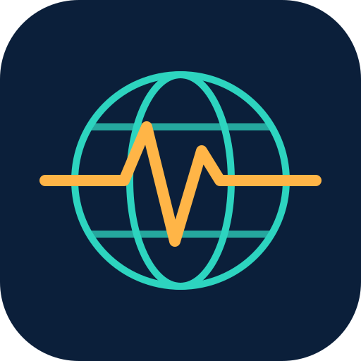

<h1 align="center">🌐 GlobalPulse MCP</h1>

<p align="center">
  <a href="https://registry.modelcontextprotocol.io/v0.1/servers?search=io.github.gpavan1992/globalpulse-mcp"></a>
  &nbsp;
  <a href="https://www.npmjs.com/package/globalpulse-mcp-server"></a>
  &nbsp;
  <a href="https://globalpulse-mcp-production.up.railway.app/health"></a>
  &nbsp;
  
  &nbsp;
  
  &nbsp;
  <a href="LICENSE"></a>
</p>

<p align="center">
  Open-source, read-only MCP server for ChatGPT, Claude and other AI clients.<br>
  Macroeconomics, weather, disasters, trade flows, aviation and country data,<br>
  from public sources, with no setup, no account and no API key.
</p>

<p align="center">
  <a href="#quick-start"><b>Quick start</b></a>
  &nbsp;&nbsp;&nbsp;
  <a href="#the-eleven-tools"><b>Tools</b></a>
  &nbsp;&nbsp;&nbsp;
  <a href="#see-it-work"><b>See it work</b></a>
  &nbsp;&nbsp;&nbsp;
  <a href="#how-a-number-gets-checked"><b>How it works</b></a>
  &nbsp;&nbsp;&nbsp;
  <a href="#data-sources"><b>Data sources</b></a>
  &nbsp;&nbsp;&nbsp;
  <a href="#privacy-and-safety"><b>Privacy</b></a>
</p>

> [!NOTE]
> GlobalPulse is an independent open-source project by an individual developer. It is not affiliated with, endorsed by or maintained by OpenAI, Anthropic, the World Bank, the United Nations, Open-Meteo, adsb.lol or any other data provider. Those names are used only to describe what the server connects to.
>
> Data is informational only. It is not a substitute for official alerts, financial advice or professional judgment.

## Does it actually work?

Public data APIs fail quietly. While building GlobalPulse against live sources, each of these came up, and each one could have produced a plausible-looking answer:

| What went wrong | What GlobalPulse does |
|---|---|
| UN Comtrade expects M49 country codes, not ISO. India is `699`, not `356` | Maps country names and ISO codes to M49 before calling |
| The public REST Countries API went offline | Country data now comes from a static, cached [mledoze/countries](https://github.com/mledoze/countries) list, with population from the World Bank |
| ADS-B sources have no "flights by country" query | The tool says its count is **approximate**, samples major hubs and flags partial coverage |
| Upstream APIs time out or return an error page | Retries once, caps the wait, and returns a clear error instead of a made-up number |
| World Bank indicators lag by 1–2 years | The data year is always shown next to the value |

The rule is the same everywhere: **retry, flag or refuse. Never guess.**

## What this is

A [Model Context Protocol](https://modelcontextprotocol.io) server with 11 tools in six areas. You ask in plain language, and the AI client picks the tool, fetches the data and explains the result.

The public server runs on Railway at:

```
https://globalpulse-mcp-production.up.railway.app/mcp
```

Health check: <https://globalpulse-mcp-production.up.railway.app/health>

No account, no login, no API key. The server is read-only and stateless: each request is handled on its own and no user data is stored.

## See it work

**ChatGPT.** One prompt asks for an "India Morning Intelligence Brief" built from live GlobalPulse tool calls: GDP and inflation, a Mumbai 7-day forecast, disaster alerts, a country profile, and a table showing which tool returned each dataset.

▶️ **[Watch the ChatGPT demo (1 min)](https://vimeo.com/1249076180)**

<!-- Add screenshots to screenshots/ and uncomment:
<p align="center">
  
</p>
-->

**Claude.** The same server works in Claude as a custom connector.

<!-- TODO: add the Claude demo, then replace this comment with the link or image:
▶️ **[Watch the Claude demo](PASTE_LINK_HERE)**
<p align="center">
  
</p>
-->

*Prices, weather and indicators in the demos are live public data.*

## Quick start

### What you need

Nothing to install for ChatGPT or Claude: you add the public URL. For desktop editors you need Node.js 18 or newer.

### ChatGPT

1. Open ChatGPT **Settings → Apps** (or Connectors) and add a custom MCP server in developer mode.
2. Paste `https://globalpulse-mcp-production.up.railway.app/mcp`.
3. Ask a question, for example *"Build me an India morning brief: GDP, inflation, Mumbai forecast and active disasters."*

### Claude

1. Open **Settings → Connectors → Add custom connector**.
2. Paste `https://globalpulse-mcp-production.up.railway.app/mcp`.
3. Ask the same question.

### Claude Desktop (config file)

Edit `~/Library/Application Support/Claude/claude_desktop_config.json` (macOS) or `%APPDATA%\Claude\claude_desktop_config.json` (Windows):

```json
{
  "mcpServers": {
    "GlobalPulse MCP": {
      "command": "npx",
      "args": ["mcp-remote", "https://globalpulse-mcp-production.up.railway.app/mcp"]
    }
  }
}
```

### Cursor / Windsurf

```json
{
  "globalpulse": {
    "command": "npx",
    "args": ["mcp-remote", "https://globalpulse-mcp-production.up.railway.app/mcp"]
  }
}
```

### Example prompts

- *"What was India's GDP trend from 2010 to 2023?"*
- *"Show active Red alert disasters globally right now"*
- *"What's the 7-day weather forecast for Mumbai?"*
- *"Show India–China bilateral trade in 2022"*
- *"What's the historical monsoon rainfall for Chennai June–September 2023?"*
- *"List all South Asian countries by population"*
- *"Compare Germany and Japan's unemployment rates 2015–2023"*
- *"Show typhoon history for the Philippines"*

## The eleven tools

### 🏦 Macroeconomics: World Bank Open Data

| Tool | What it does |
|---|---|
| `globalpulse_worldbank_get_indicator` | GDP, inflation, unemployment, trade, debt for any country (1960–present) |
| `globalpulse_worldbank_list_indicators` | The most useful World Bank indicator codes |

### 🌤️ Climate and weather: Open-Meteo

| Tool | What it does |
|---|---|
| `globalpulse_weather_get_forecast` | 7-day daily forecast for any latitude and longitude |
| `globalpulse_weather_get_historical` | Historical climate back to 1940 (ERA5 reanalysis) |

### 🚨 Disasters: UN GDACS

| Tool | What it does |
|---|---|
| `globalpulse_disasters_get_active` | Live global alerts: earthquakes, cyclones, floods, volcanoes |
| `globalpulse_disasters_get_by_country` | Disaster history for one country |

### ✈️ Aviation: adsb.lol

| Tool | What it does |
|---|---|
| `globalpulse_aviation_get_live_flights` | Live ADS-B flights in a bounding box (split into circles of up to 250 nm, max 25 requests) |
| `globalpulse_aviation_get_flights_by_country` | **Approximate** airborne flights registered in India, Germany or the United States, sampled around major hubs. Not a national total |

### 📦 Trade: UN Comtrade

| Tool | What it does |
|---|---|
| `globalpulse_trade_get_bilateral_flows` | Bilateral import and export flows by country pair and HS commodity code |

### 🗺️ Countries: mledoze/countries + World Bank

| Tool | What it does |
|---|---|
| `globalpulse_countries_get_profile` | Capital, population, currencies, languages and borders. Accepts a name or ISO alpha-2/alpha-3 code |
| `globalpulse_countries_get_by_region` | Countries in a region or subregion, sorted by population, area or name |

All tools accept `response_format: "markdown"` (default) or `"json"` for agent pipelines.

## How a number gets checked

1. **Resolve the input.** Country names and ISO codes are mapped to what each source expects (for example M49 for UN Comtrade).
2. **Fetch from the primary source.** Each tool calls one named public provider. There is no scraped or paid data.
3. **Retry once, then say so.** Timeouts and upstream errors are retried with a capped wait. If it still fails, the tool returns a clear error.
4. **Label what is approximate.** Aviation by country is marked approximate, and coverage gaps are named.
5. **Show the provenance.** Responses carry the source and data year, and aviation responses carry the adsb.lol ODbL attribution.

## Data sources

| Domain | Source | License | Key required |
|---|---|---|---|
| Macroeconomics | [World Bank Open Data](https://data.worldbank.org) | CC BY 4.0 | No |
| Weather and climate | [Open-Meteo](https://open-meteo.com) + ERA5 | CC BY 4.0 | No |
| Disaster alerts | [UN GDACS](https://www.gdacs.org) | UN Open Data | No |
| Aviation | [adsb.lol](https://adsb.lol) | [ODbL 1.0](https://opendatacommons.org/licenses/odbl/1-0/), attribution required | No |
| Trade flows | [UN Comtrade](https://comtradeplus.un.org) | UN Open Data | No (free tier) |
| Country data | [mledoze/countries](https://github.com/mledoze/countries) (static list, cached 24 h) | ODbL 1.0 | No |

<details>
<summary><b>Notes and limits</b></summary>

- Weather coordinates use decimal degrees (for example `19.076, 72.877` for Mumbai). Aviation velocity is shown in km/h.
- UN Comtrade's free tier has a daily request limit. Use `"TOTAL"` for `commodity_code` for the best availability.
- World Bank data lags 1–2 years for some indicators. Use `end_year=2022` for the best coverage.
- Aviation data comes from adsb.lol under the ODbL 1.0. [adsb.fi](https://adsb.fi) can be enabled as a fallback in your own deployment with `ADSBFI_ENABLED=true` (default `false`, and off on the public server). Its terms allow personal, non-commercial use only and require attribution, so check them first.
- adsb.lol caps the search radius at 250 nm, reports a quota of about 500 requests per day per IP, and returns HTTP 429 when bursts exceed its limit. Each tool call can make several upstream requests, at most 2 in flight at a time. Results are cached in memory for 60 s per area. While adsb.lol is rate-limited, areas with a cached result (up to 15 minutes old) are served from the cache and flagged in the output. Otherwise the tool returns "temporarily rate-limited, retry in N s".
- `get_flights_by_country` samples circles around major hubs and matches aircraft by ICAO24 address block. Alaska and Hawaii are not covered, at most 6 hubs are sampled per call, and the United States is flagged as partial coverage.

</details>

## Privacy and safety

| Control | Status |
|---|---|
| Read-only: no orders, transfers, trades or writes to third-party systems | ✅ |
| No accounts, logins, passwords or API keys requested | ✅ |
| Stateless: the server stores no user data | ✅ |
| Open source: every line auditable | ✅ |
| Tool descriptions contain no instructions about model behavior | ✅ |
| Hosting logs | ○ The host (Railway) may keep standard request logs, see [PRIVACY.md](PRIVACY.md) |
| Data-source guarantees | ○ Public endpoints that can change, lag or go down without notice |

[PRIVACY.md](PRIVACY.md) lists what is forwarded to third-party data providers. Use of the public server is subject to [TERMS.md](TERMS.md).

## Is this for you?

**Good fit if you** want an AI assistant to answer questions with live public data (economics, weather, disasters, trade, flights, countries), want to see which tool and source produced each number, and want something free that needs no signup.

**Not a fit if you** need real-time safety alerts, investment or trading advice, an exact national flight count, or guaranteed uptime for a business-critical workflow.

## Roadmap

- ✅ **v1.0** 11 tools across six public data sources, public Railway endpoint, MCP Registry and npm listing
- ⏳ **Directories** Submission to the ChatGPT and Claude connector directories
- [ ] Rate limiting and response caching on the public server
- [ ] Priority 2 tools: IMF, Copernicus, USGS seismology, Global Forest Watch, OpenAQ, ECB FX rates
- [ ] Priority 3 tools: WHO health, NASA EONET, WTO tariffs, NOAA climate

See [ROADMAP.md](ROADMAP.md) for the full plan. *Roadmap items are intentions, not commitments.*

## File structure

<details>
<summary>Show the repository layout</summary>

```
Globalpulse-MCP/
├── src/
│   ├── index.ts               # Express server, /mcp, /health
│   ├── constants.ts
│   ├── types.ts
│   ├── services/              # API clients (adsb.lol, World Bank, Comtrade, ...)
│   └── tools/                 # one module per tool area
├── assets/                    # icon
├── server.json                # MCP Registry manifest
├── package.json
├── PRIVACY.md
├── TERMS.md
├── ROADMAP.md
└── LICENSE
```

</details>

## Contributing

PRs are welcome, especially for Priority 2 tools. Open an issue to claim a tool before starting. The most useful report is a **data trap**: a result that looked right and was not.

```bash
npm install
npm run build
TRANSPORT=http npm start    # http://localhost:3000/mcp (default transport is stdio)
```

## Built by

**Pavan Kumar Galiveeti**, a product leader building AI products, built in public with [Claude](https://claude.com) as pair programmer. Feedback is welcome on [LinkedIn](https://www.linkedin.com/in/pavan-kumar-galiveeti-a44335192/) or in [issues](https://github.com/gpavan1992/Globalpulse-MCP/issues).

## License

[MIT](LICENSE). Free to use, modify and redistribute, including commercially. Keep the copyright notice.

<p align="center">
  <br>
  <sub>Data comes from public sources that can be wrong or delayed. Verify before you act.</sub>
</p>
